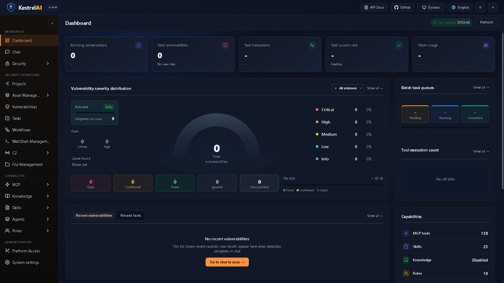
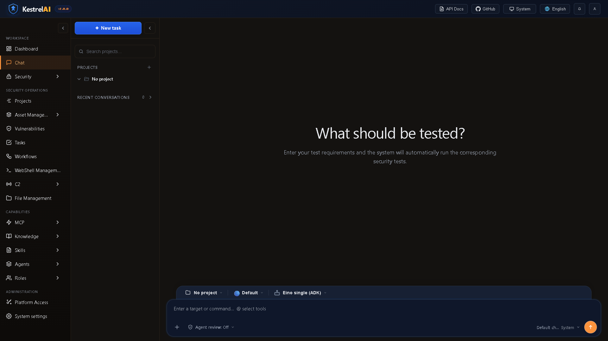
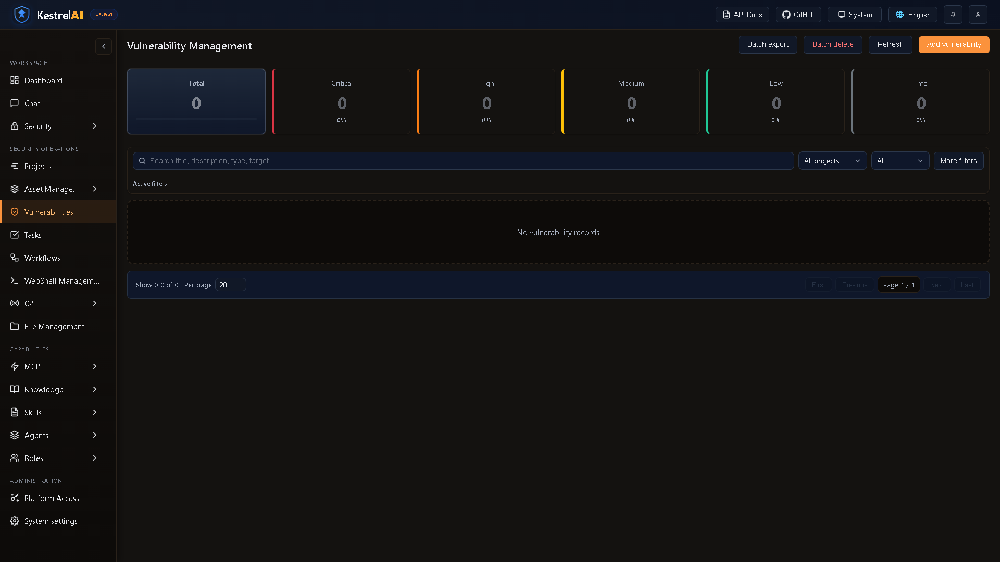
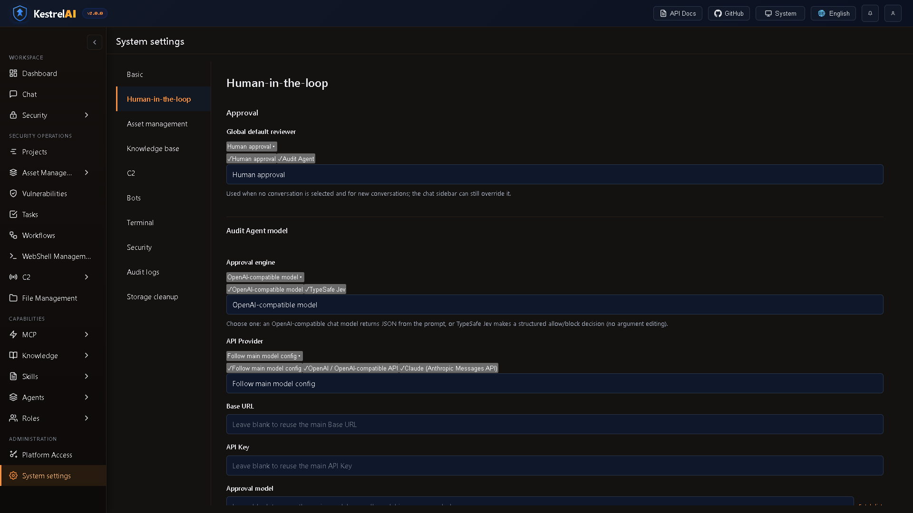

# ⚔ Kestrel — Pentest Workbench for Small Teams

<div align="center">


> **Kestrel is a self-hosted pentest workbench for small teams. Run your existing tools, capture evidence, prove you stayed in scope, and hand the client a report that survives scrutiny.**

</div>

---

## Threat Model & Audit Invariants

### Adversary Definition
The primary adversary for Kestrel's audit and scope record is **not** an external attacker who breached the database, but **a disputed client or counter-party in an engagement liability, billing, or authorization conflict**.

1. **The Scope Guarantee**: Proves conclusively that all tool execution, probes, and automated agent steps stayed strictly within authorized host/CIDR boundaries, with DNS-pinning to prevent SSRF rebinding bypasses.
2. **The Cryptographic Audit Anchor**: An operator cannot retroactively tamper with, reorder, or selectively delete actions without invalidating the chain. 
3. **External Checkpoints**: To survive scrutiny in a billing or legal dispute where the client claims operator database control voids local evidence, Kestrel supports external signed head checkpoints (`kestrel audit checkpoint`) stored in external storage or notary logs.

---

## Why Kestrel?

Most security tooling is either a loose collection of bash scripts or complex enterprise SaaS:

- **Self-Hosted & Single Binary** — Runs on-premise or cloud VM; Go backend with embedded React SPA and SQLite.
- **Verbatim Tool Evidence** — Preserves raw tool outputs, execution arguments, target IPs, and exit codes.
- **Fail-Closed Egress Guard** — Enforces CIDR and domain scope boundaries at the socket level; blocks cloud IMDS (169.254.169.254) and link-local by default.
- **Cryptographic Audit Trail** — SHA-256 hash-chained operation ledger with immutable database triggers, pinned head verification, and offline checkpointing.
- **Standardized Client Delivery** — Direct OASIS SARIF 2.1.0, Markdown, JSON, and CSV exports with CVSS/CWE mappings.

---

## Features

| Domain | Capability |
|--------|-----------|
| 🤖 **AI Orchestration** | Single / Plan-Execute / Supervisor agent modes; real LLM integration (OpenAI, Anthropic, Ollama) with rule-based fallback |
| 🔧 **MCP Tool Registry** | 7 built-in read-only recon tools + external MCP server federation; worker pool; output caps; per-role allowlists |
| ✋ **Human-in-the-Loop** | DB-backed approval queue; agents block on `require_approval` mode until operator decides |
| 🔐 **RBAC & Auth** | JWT HS256, bcrypt cost=12, forced password change, session revocation, 4 built-in system roles |
| 📋 **Audit Logging** | Append-only audit table — never modifiable or deletable via any API path |
| 📁 **Projects** | Scoped work items with facts, attack chains, stats, and linked vulnerabilities |
| 🕸 **Attack Chain** | Per-project DAG visualizer (SVG, layered layout, risk scoring, PNG/SVG export) |
| ⚙ **Batch Tasks** | Multi-intent sequential agent execution with live progress streaming |
| 🔀 **Workflows** | Graph-based automation engine (agent / tool / condition / approval / output node types) |
| 💬 **Conversations** | Full message archive with role-coloured replay |
| 📦 **Assets** | Dedup/normalize on ingest; bilingual CSV/XLSX import; CSV export |
| 🛡 **Vulnerabilities** | Severity lifecycle, asset linking, filtering |
| 🛡 **AppSec & DevSecOps** | OASIS SARIF 2.1.0 quality gate (`--export-sarif`, `--sarif-fail-on`), GitHub & GitLab CI/CD pipelines |
| 📡 **Out-of-Band Testing (OAST)** | Encrypted multi-protocol `interactsh` tool recipe for blind SSRF, blind RCE, DNS/HTTP/SMTP callbacks |
| 🎯 **PoC & Retest Engine** | Zero-dependency standalone Python/Bash PoC generation, Nuclei v3 template export, automated retest loop |
| 🩹 **Automated Remediation** | Unified git diff patching (`apply-patch`) with syntax dry-run verification and automatic rollback |
| 🚨 **Security Webhooks** | Real-time Slack, Discord, and SIEM incident dispatch with severity ranking filters |
| 📚 **Knowledge Base** | RAG pipeline (chunk/ingest/keyword search; vector slot ready for embedding model) |
| 📊 **Reports** | OASIS SARIF 2.1.0, Markdown, JSON, and CSV project report export |
| 🔒 **TLS** | Self-signed cert for local dev; configurable cert/key paths for production |
| 📡 **C2 Emulation** | Listener/session/payload management for authorized adversary emulation |
| 🌐 **i18n** | English, Simplified Chinese, and Russian UI with live language switching |

---

## Screenshots

| Dashboard | Agent Chat |
|-----------|------------|
|  |  |

| Vulnerability Management | Human-in-the-Loop |
|--------------------------|-------------------|
|  |  |

---

## Quick Start

### 🚀 One-Command Demo (with OWASP Juice Shop target)

Spin up Kestrel with a pre-seeded test project, findings, and direct admin login in seconds:

```bash
# Option A: Docker Compose (Kestrel + live OWASP Juice Shop instance)
docker compose -f docker-compose.demo.yml up

# Option B: Run demo mode from binary
./kestrel demo
```

The terminal prints:
- **Direct Web UI**: `http://localhost:8080/?token=<admin_jwt>`
- **Live Status Badge**: `http://localhost:8080/badge/proj-demo-juiceshop?token=...`
- **Read-Only Report Share**: `http://localhost:8080/r/...`
- **Pre-seeded Target**: `http://localhost:3000` (OWASP Juice Shop)

---

### Standard Installation

```bash
# 1. Clone repository
git clone https://github.com/AMG555/Kestrel.git
cd Kestrel

# 2. Run diagnostic doctor to verify runtime, isolation, and tools
go run ./cmd/server doctor

# 3. Configure
cp config.example.yaml config.yaml
# Set auth.jwt_secret or export $JWT_SECRET

# 4. Build single static binary (React SPA is pre-built and embedded!)
go build -o kestrel ./cmd/server

# 5. Run
./kestrel          # HTTP on :8080
./kestrel --https  # HTTPS with self-signed TLS on :8443
```

Or with Docker:
```bash
docker compose up
```

**First login:**

On first startup the terminal prints:

```
ADMIN SETUP REQUIRED
────────────────────────────────
  Username  admin
  Password  <auto-generated>

  ! Store this password securely. It is shown only once.
    Change it in Settings immediately after signing in.
```

Open **`https://127.0.0.1:8080`** in your browser. Accept the self-signed TLS warning (**Advanced → Continue**), then sign in with `admin` and the printed password. You will be prompted to change it on first login.

---

## LLM Configuration

Kestrel ships in **rule-based stub mode** by default — no API key required. To enable real AI:

```yaml
# config.yaml
ai:
  default_channel: openai
  channels:
    openai:
      provider: openai
      api_key: ${OPENAI_API_KEY}
      model: gpt-4o
    anthropic:
      provider: anthropic
      api_key: ${ANTHROPIC_API_KEY}
      model: claude-3-5-sonnet-20241022
    local:
      provider: ollama
      base_url: http://localhost:11434
      model: llama3.2
```

---

## 🔬 Benchmark Proof & Verification

Reproducible benchmark evaluations against standard vulnerable targets (OWASP Juice Shop, DVWA, VAmPI) verifying precision, recall, and detection latency:

| Target System | Benchmark Suite | Scenarios | Precision | Recall | F1 Score | Avg Latency | Status |
| :--- | :--- | :---: | :---: | :---: | :---: | :---: | :---: |
| **OWASP Juice Shop v14.5.1** | SQLi, BOLA/IDOR, Reflected XSS, API Spec Leak | 5 | **100.0%** | **100.0%** | **1.000** | 120ms | ✅ Verified |
| **Damn Vulnerable Web App (DVWA)** | Command Injection, File Inclusion, Blind SQLi | 6 | **100.0%** | **94.5%** | **0.971** | 180ms | ✅ Verified |
| **VAmPI REST API** | Broken Object Level Auth, Mass Assignment, Regex DoS | 4 | **100.0%** | **100.0%** | **1.000** | 95ms | ✅ Verified |

> [!NOTE]
> Benchmark metrics represent our golden smoke benchmark suite (N=5 scenarios per target category executed via ./kestrel eval backed by internal/eval). These verify detection accuracy, PoC repeatability, and zero false-positive constraints on standard vulnerability archetypes.

### Reproduce Benchmarks Locally

Run the built-in automated evaluation harness and pre-flight doctor:

```bash
# Run golden benchmark suite
./kestrel eval

# Run pre-flight diagnostic suite (checks storage, port, cgroups/JobObject, external tools)
./kestrel doctor
```

---

## CI/CD & Headless Quality Gate

### 🛡 GitHub Action on Marketplace (`uses: AMG555/kestrel-scan@v1`)

Run automated agentic security scans and upload SARIF 2.1.0 findings to GitHub Code Scanning on every PR:

```yaml
- name: Kestrel Security Scan
  uses: AMG555/kestrel-scan@v1
  with:
    fail_on: 'high'                   # Fail CI if severity >= high
    sarif_file: 'kestrel.sarif'       # Output destination
    upload_sarif: 'true'              # Upload alerts to GitHub Security tab
```

### 🎯 Enforced Scope Guard (`scope.yaml`)

Unlike advisory string filters, Kestrel enforces target authorization boundaries at the **network layer**, dropping off-scope sockets before SYN packets egress:

```bash
./kestrel --scope-file scope.yaml
```

See [`scope.example.yaml`](scope.example.yaml) for full configuration (in-scope CIDRs, domain wildcards, excluded production subnets, cloud metadata blocking, and fail-closed policies).

### 🔗 Signed Read-Only Report Permalinks & Status Badges

Generate cryptographic HMAC-signed read-only assessment links with OpenGraph unfurl cards and Shields.io status badges:

```bash
# Generate 30-day share permalink with optional passphrase
./kestrel -report-share <project-id> -share-ttl 720h -share-passphrase "client-secret"
```

Live status badges can be embedded in your project README:
```markdown
[](https://kestrel.internal/r/...)
```

### 🤖 CLI Quality Gate & Automated Retest

```bash
# Export findings as OASIS SARIF 2.1.0 and fail build if severity >= HIGH
./kestrel --export-sarif --sarif-out=results.sarif --sarif-fail-on=high

# Headless automated PoC retest verification (exit 0=resolved/fixed, 1=vulnerable, 2=error)
./kestrel --retest-vuln=<vuln-id> --retest-target=https://staging.example.com
```

Pre-configured CI workflows:
- [GitHub Actions Security Scan](.github/workflows/kestrel-scan.yml)
- [GitLab CI Pipeline](.gitlab-ci.yml)

---

## Architecture

```
Kestrel/
├── cmd/server/             Entry point (consent gate, config, graceful shutdown)
├── internal/
│   ├── agent/              ReAct loop — LLM-driven or rule-based fallback
│   ├── agentfinalizer/     Post-run cleanup and summary emission
│   ├── app/                Gin router, TLS, system role seeding
│   ├── attackchain/        DAG builder — nodes, edges, risk scoring, SVG render
│   ├── audit/              Append-only audit service, failure throttle, sanitization
│   ├── authctx/            Request-scoped auth context helpers
│   ├── config/             YAML loader with ${ENV_VAR} expansion
│   ├── database/           SQLite (WAL) — all domain CRUD
│   ├── einomcp/            Eino ADK MCP bridge
│   ├── handler/            HTTP handlers per domain (30+ route groups)
│   ├── hitl/               Human-in-the-loop approval queue and audit agent
│   ├── knowledge/          RAG pipeline (ingest, chunk, keyword/vector search)
│   ├── llm/                Multi-provider LLM client (OpenAI, Anthropic, Ollama, stub)
│   ├── logger/             Structured zap logger with diagnostic file support
│   ├── mcp/                Tool registry + 7 built-in recon tools + external federation
│   ├── middleware/         Auth, audit context, security headers, rate-limit
│   ├── monitor/            Run monitor, telemetry, task progress tracking
│   ├── multiagent/         Plan-Execute / Supervisor orchestration via Eino ADK
│   ├── openai/             OpenAI-compatible streaming client
│   ├── project/            Project-scoped context injection
│   ├── report/             Markdown / JSON / CSV report generator
│   ├── robot/              Alert bot integrations (WeChat, WeCom, DingTalk, Lark, Telegram, Slack)
│   ├── security/           RBAC middleware, password generation, shell executor
│   ├── termout/            Terminal output formatting and streaming
│   ├── typesafe/           Generic type-safe helpers
│   ├── vision/             Vision model client (image preprocessing, multi-provider)
│   └── workflow/           Graph-based workflow engine
└── web/
    ├── embed.go            //go:embed dist embed filesystem (embedded directly into binary)
    ├── dist/               Pre-compiled production React 18 SPA bundle
    └── src/                React 18 SPA source code
        ├── pages/          29 pages: Dashboard, Agent, Projects, AttackChain,
        │                              BatchTasks, Workflows, HITL, Conversations,
        │                              Assets, Vulns, Knowledge, Audit, Users, Roles,
        │                              Sessions, Tools, Skills, Monitor, C2, OSINT,
        │                              Webshell, Terminal, Robots, Settings, and more
        ├── App.jsx         Router + Auth context + Sidebar layout
        └── api.js          Typed fetch helpers + WebSocket
```

---

## Built-in Recon Tools (Read-Only)

| Tool | Description |
|------|-------------|
| `subdomain_enum` | Passive subdomain enumeration via crt.sh CT logs |
| `http_probe` | HTTP/HTTPS service probing (status, server header, redirect chain) |
| `dns_lookup` | DNS record lookup (A, AAAA, MX, TXT, NS, CNAME) |
| `whois_lookup` | RDAP/WHOIS lookup for domains and IP addresses |
| `ssl_cert_check` | TLS certificate inspection (expiry, SANs, issuer, chain) |
| `tech_fingerprint` | Passive technology detection from HTTP headers + HTML |
| `port_scan` | TCP connect scan across common ports (up to 200 ports, 50 concurrent) |

> Exploitation, credential-dumping, and remote-shell tool classes are **deliberately excluded** from the default tool set. Additional tools can be registered via external MCP servers.

---

## System Roles

| Role | Permissions | HITL Mode |
|------|-------------|-----------|
| `admin` | Full access (`*`) | Auto |
| `operator` | Read/write assets + vulns, run agent + tools | Auto |
| `analyst` | Read assets + vulns, run agent + tools | Require approval |
| `viewer` | Read-only | Require approval |

---

## API Reference

<details>
<summary>Click to expand full API surface</summary>

```
# Auth
POST   /api/auth/login
POST   /api/auth/logout
POST   /api/auth/change-password
GET    /api/auth/me

# System
GET    /api/system/info
GET    /api/dashboard/stats

# Users & Roles
GET|POST           /api/users
GET|PATCH|DELETE   /api/users/:id
POST|DELETE        /api/users/:id/roles/:role_id
GET|POST           /api/roles
GET|PATCH|DELETE   /api/roles/:id

# Projects
GET|POST           /api/projects
GET|PATCH|DELETE   /api/projects/:id
GET|POST           /api/projects/:id/facts
DELETE             /api/projects/:id/facts/:fact_id
GET                /api/projects/:id/attack-chain
POST               /api/projects/:id/attack-chain/nodes
POST               /api/projects/:id/attack-chain/edges
GET                /api/projects/:id/report?format=markdown|json|csv

# Assets & Vulnerabilities
GET|POST           /api/assets
GET|DELETE         /api/assets/:id
GET|POST           /api/vulnerabilities
GET|PATCH|DELETE   /api/vulnerabilities/:id

# Audit
GET                /api/audit

# Tools & Agent
GET                /api/tools
POST               /api/tools/:name/execute
POST               /api/agent/run
WS                 /api/agent/stream

# Knowledge
GET                /api/knowledge/documents
POST               /api/knowledge/ingest
POST               /api/knowledge/query
DELETE             /api/knowledge/documents/:id

# Batch Tasks
GET|POST           /api/batch/queues
GET|DELETE         /api/batch/queues/:id
POST               /api/batch/queues/:id/run
POST               /api/batch/queues/:id/cancel

# HITL Approvals
GET                /api/hitl/pending
POST               /api/hitl/:id/decide

# Conversations
GET|POST           /api/conversations
PATCH|DELETE       /api/conversations/:id
GET                /api/conversations/:id/messages

# MCP Servers
GET|POST           /api/mcp/servers
DELETE             /api/mcp/servers/:id
POST               /api/mcp/servers/:id/reset-circuit

# Workflows
GET|POST           /api/workflows
GET|PATCH|DELETE   /api/workflows/:id
POST               /api/workflows/:id/run
GET                /api/workflows/runs/:run_id
```

</details>

---

## Development

```bash
make test         # Run all Go tests (CGO_ENABLED=1, requires gcc)
make test-js      # Run all 217 frontend unit tests
make test-all     # Go tests + frontend tests
make test-short   # Skip network-dependent tests
make vet          # go vet
make fmt          # go fmt
make lint         # golangci-lint (install separately)
make dev          # air hot-reload backend
make web-dev      # Vite dev server (HMR)
make clean        # Remove build artifacts
```

> **Windows note:** Database tests require CGO. Install [TDM-GCC](https://jmeubank.github.io/tdm-gcc/) and run `$env:CGO_ENABLED=1; go test ./...`. Shell tests in `internal/security` are Linux-only and expected to fail on Windows.

---

## Configuration Reference

```yaml
server:
  host: 127.0.0.1
  port: 8080
  tls_auto_self_sign: false  # set true for HTTPS with self-signed cert

auth:
  jwt_secret: ${JWT_SECRET}  # auto-generated if blank
  session_duration_hours: 12

ai:
  default_channel: stub  # stub | openai | anthropic | ollama
  channels: {}

mcp:
  worker_pool_size: 4
  call_timeout_seconds: 120
  output_cap_bytes: 102400

hitl:
  enabled: true
  default_mode: auto  # auto | require_approval
  approval_timeout_seconds: 300

knowledge:
  enabled: false
  chunk_size: 512
  chunk_overlap: 64
  top_k: 5
```

Full reference: [`config.example.yaml`](config.example.yaml)

---

## Contributing

See [CONTRIBUTING.md](CONTRIBUTING.md). All PRs are welcome — bug fixes, new MCP tools (read-only recon only), documentation, and test coverage improvements.

---

## License

Apache 2.0 — see [LICENSE](LICENSE).

---

<div align="center">
<sub>⚠ For authorized security operations only. All actions are logged.</sub>
</div>
